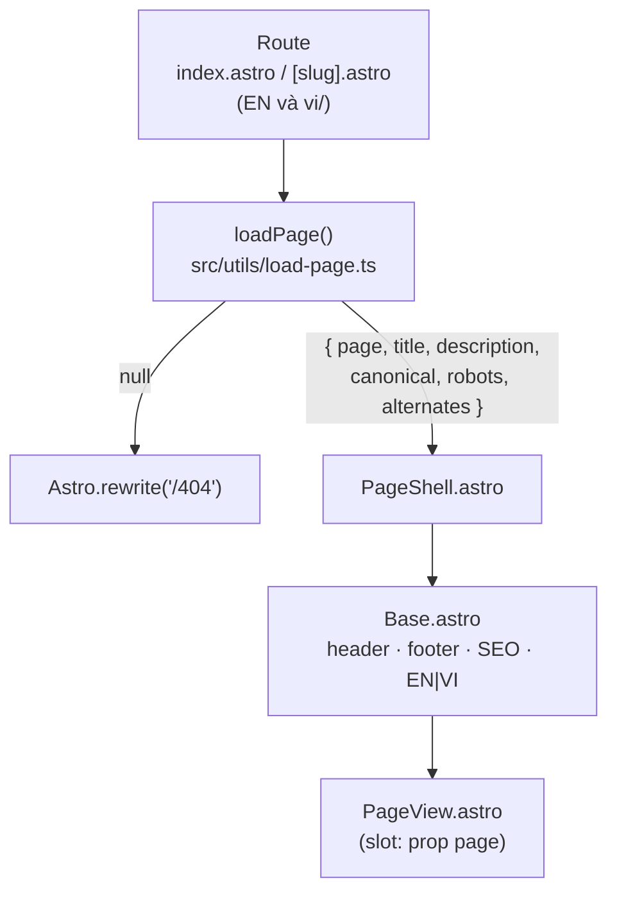
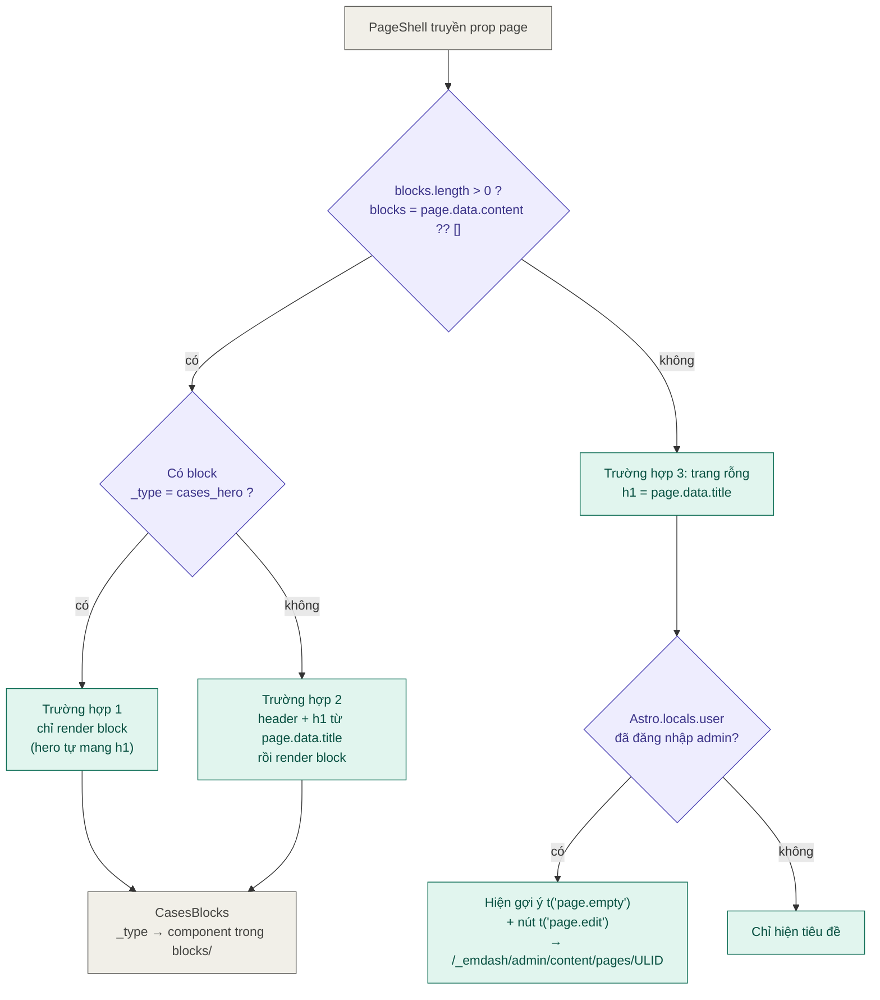

# PageView.astro — luồng render

`src/components/PageView.astro` là phần thân của một trang CMS (collection `pages`), nằm bên trong layout `Base` do `PageShell` cung cấp.

## 1. Vị trí trong chuỗi render

## 2. Logic bên trong PageView

## 3. Bảng tóm tắt

| Trường hợp | Điều kiện | Kết quả |
| --- | --- | --- |
| 1 | Có block và có `cases_hero` | Chỉ render block (hero tự mang `<h1>`) |
| 2 | Có block, không có hero | `<header><h1>` từ `page.data.title`, rồi render block |
| 3 | Không có block | `<h1>` tiêu đề; nếu đã đăng nhập thêm gợi ý và nút sửa trang |

## 4. Ghi chú

- Chỉ có một `<h1>` trên mỗi trang: biến `hasHero` ngăn việc in thêm `<h1>` khi hero đã có.
- `{...page.edit.title}` và `{...page.edit.content}` là các thuộc tính `data-*` của EmDash cho chỉnh sửa trực quan; ngoài chế độ edit chúng không sinh gì.
- Trường hợp 3 không phải 404: trang vẫn tồn tại, chỉ là chưa có block.
- `page.data.id` (ULID trong DB) mới là thứ URL admin cần, khác với `page.id` (slug, có tiền tố `vi/` ở bản tiếng Việt).
